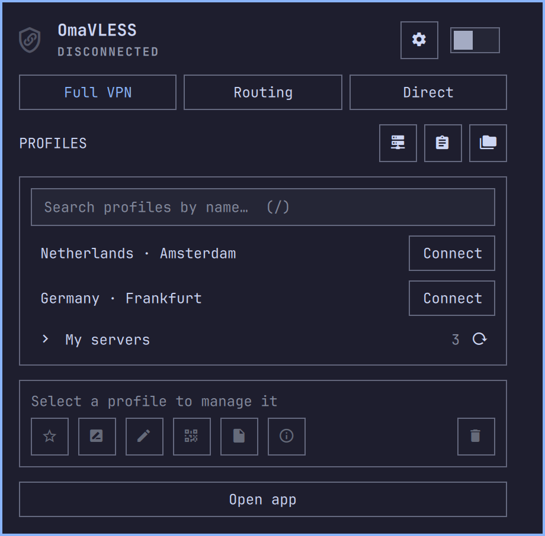
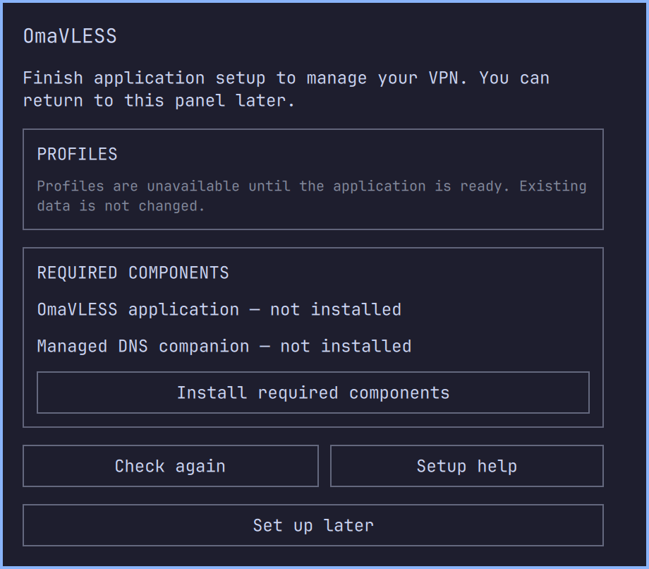
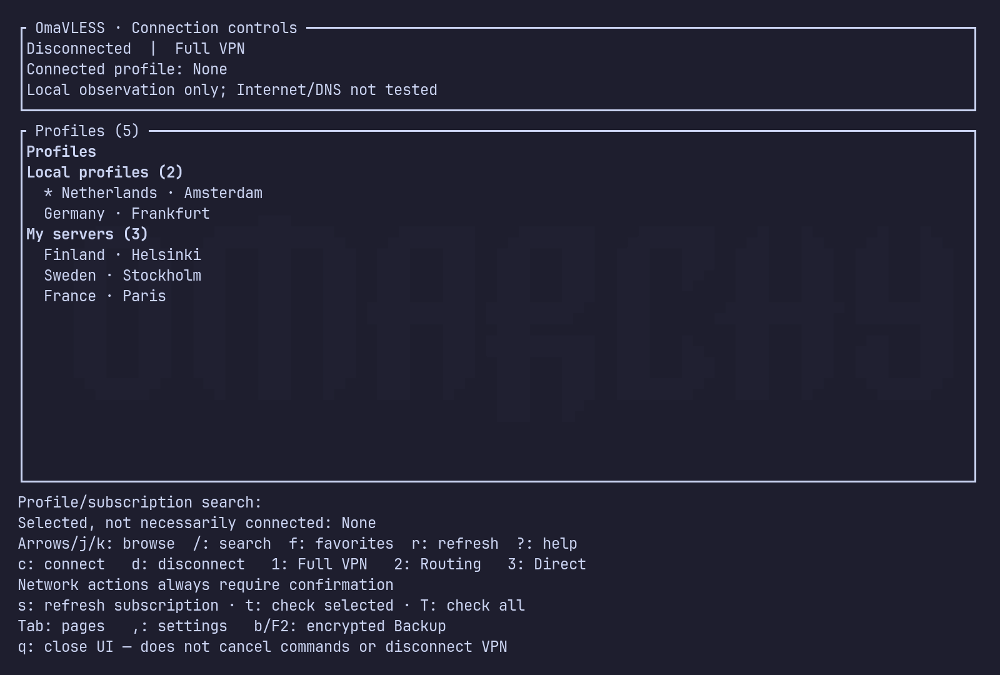

# OmaVLESS

OmaVLESS is a VPN app for Omarchy that puts everyday connection controls
directly in the bar.

Import your own compatible VLESS profile or HTTPS subscription, choose a mode,
and connect from one compact, terminal-style panel. Open the terminal
application when you want more room.

Free and open source. **OmaVLESS is not a VPN provider:** VPN servers and
service subscriptions are not included.



*Screenshots use example profiles and setup states to protect private data.
No live VPN connection is shown.*

## Get started

**OmaVLESS 0.9.8 is available for Omarchy on x86-64 and ARM64.** Start from
the plugin — no Rust build or manual package selection is needed.

```sh
omarchy plugin add https://github.com/k-kostin/omavless.git --enable
```

Turn off other VPN connections, open OmaVLESS from the bar and choose
**Install required components**. The terminal installs the matching application,
bundled Mihomo core and DNS helper for website-address lookup. Enter `INSTALL`,
then `DNS` when asked; passwords go only into the system's password prompt.
Setup does not connect a VPN. Follow onboarding to add your own profile or
subscription, then press **Connect** beside the server you want.



The [user guide](docs/user/NATIVE_INSTALL.md#install) covers installation,
partial setup, everyday use and optional tools. You do not need to install
Mihomo separately. [A guide for your assistant](docs/user/USER_AGENT_GUIDE.md)
explains the same supported actions and privacy boundaries.

The command above follows upstream main. Marketplace verification covers a
separate exact snapshot and may lag behind the GitHub release.

## Update or reinstall

Update the plugin first:

```sh
omarchy plugin update kdk.omavless
```

Open OmaVLESS and follow the next step offered in the panel. Application and
DNS-helper packages update separately from the plugin. Normal updates preserve
profiles and settings; see the [update instructions](docs/user/NATIVE_INSTALL.md#updates).

To start fresh, use [Remove](docs/user/NATIVE_INSTALL.md#remove) or the
[short terminal removal guide](docs/user/CLEAN_REINSTALL_098.md).
**Full removal deletes saved profiles/settings without a backup.** Other VPN
clients and a separately installed Mihomo stay. The helper normally needs one
restart; the same command resumes removal afterward, even without the widget.
Ordinary `omarchy plugin remove` removes only the widget, not the app or data.

For unfinished setup or old controls after an update, follow
[the user guide](docs/user/NATIVE_INSTALL.md#help) instead of reinstalling blindly.

## Which mode should I choose?

| Mode | What it does |
| --- | --- |
| **Full VPN** | Sends traffic through your connected VPN profile. Start here if you want a straightforward VPN connection. |
| **Routing** | Uses a country policy and your domain/IP rules to decide which traffic goes directly and which uses the VPN. |
| **Direct** | Bypasses the proxy while keeping the TUN interface running. This is not Disconnect. |

## Everyday controls

Expand a subscription to browse its profiles. Press **↻** beside its server
count to download an updated server list — no need to re-import the URL.

The management bar below the list offers favorite, rename, edit, QR, export,
details and delete for the selected profile. Subscription profiles keep their
editing restrictions; search does not change the connection.

Settings contains language, subscriptions, routing, diagnostics and shutdown.
English/Russian switching does not restart your VPN. Login autoconnect is Off
by default.

[View an expanded subscription](docs/marketing/images/subscription-en.png)
· [Connect and disconnect](docs/user/NATIVE_INSTALL.md#connect-and-disconnect)

## Open the app for more room

Press **Open app** below the Profile actions bar to open OmaVLESS in a terminal.
If it is already open, the button brings you back to that same window.



Use the wider workspace for traffic, active connections, routing, checks and
diagnostics. It shares the same VPN connection with the plugin, not a second
tunnel; both interfaces stay in sync.

**Tab / Shift+Tab** switch pages; `?` shows help. Press `q` or close the terminal
when done — **closing the window does not stop your VPN**. Disconnect stops the
connection; **Shut down OmaVLESS** in the plugin's Settings stops the application
and disables the plugin after confirmation.

0.9.8 includes encrypted **Backup** for profiles, subscriptions and supported
bundled routing templates. It is not a whole-system backup; **Restore is not
included yet**. See [Backup usage and limits](docs/user/NATIVE_INSTALL.md#encrypted-backup).

## Supported inputs

| Family | Status |
| --- | --- |
| VLESS | Primary supported family, including compatible TCP, WebSocket, HTTP, H2, gRPC and XHTTP configurations with TLS/REALITY |
| Trojan, Hysteria2, TUIC v5 | Experimental; real-server coverage is incomplete |
| Subscriptions | HTTPS raw/base64 lists of supported profile links |

Advanced VLESS Encryption/REALITY PQ and XHTTP combinations retain their
experimental limitations. WireGuard, AmneziaWG, `vpn://` keys and arbitrary
remote Clash/Mihomo YAML are not supported inputs.

See [protocol support and limitations](docs/user/PROTOCOLS.md).

## Privacy and help

Open **Settings → Help**, or **Setup help** during installation. Copy the ready
request into Codex, Claude or another assistant on this computer and describe
your problem at the end. The request points to the instructions installed with
your plugin. You can also read the guide or report a problem directly; using
an assistant is optional.

Profiles and subscription URLs stay in a private local store. For support,
use **Copy report** or **Save file** in Settings → Support report. Do not post
profile files, subscription URLs, private configuration, backup archives or
unredacted screenshots.

- [Troubleshooting](docs/user/TROUBLESHOOTING.md)
- [User guide and FAQ](docs/user/NATIVE_INSTALL.md#help)
- [Security and privacy](docs/user/SECURITY.md)
- [Updates, Quit and removal](docs/user/NATIVE_INSTALL.md#updates-close-quit-and-removal)
- [Release notes](CHANGELOG.md)

## Credits and license

Maintained by [kdk](https://github.com/k-kostin). Community project; not
affiliated with Omarchy, MetaCubeX or a VPN provider.

The interface builds on [Omarchy VPN](https://github.com/jkoestinger/omarchy-vpn)
by Justin Köstinger. Routing data comes from RoscomVPN, MetaCubeX and
Chocolate4U. See [third-party notices](THIRD_PARTY_NOTICES.md).

[MIT License](LICENSE) · [Contributing](CONTRIBUTING.md)
